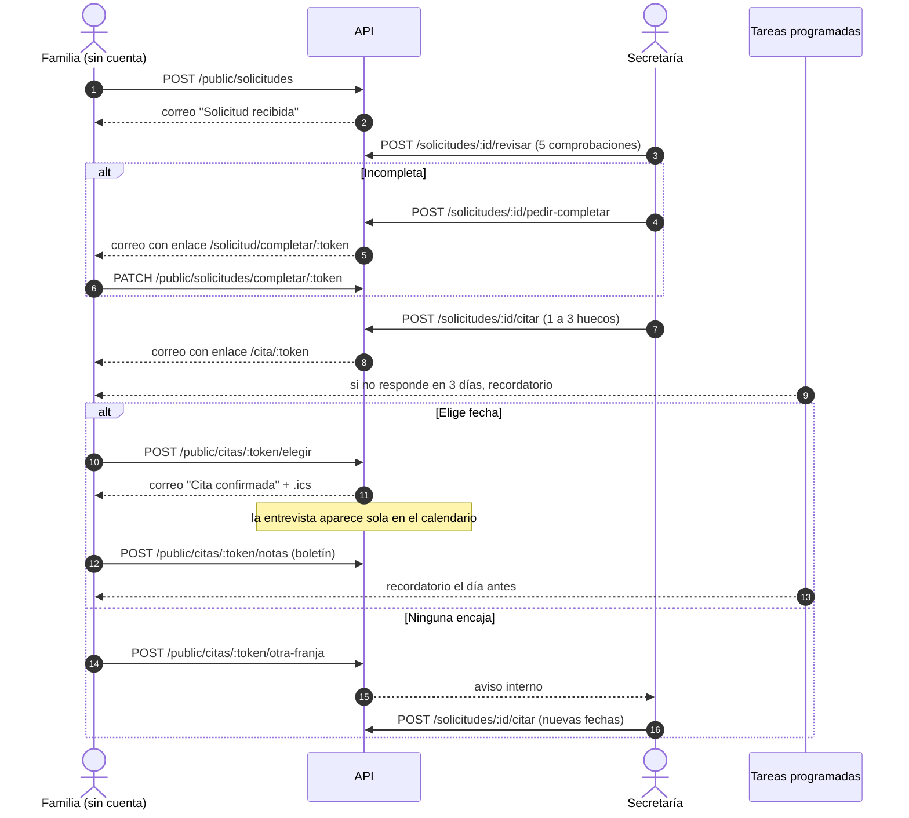
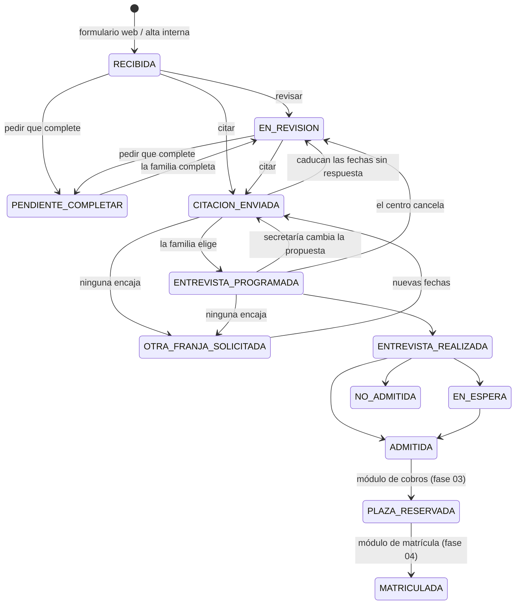
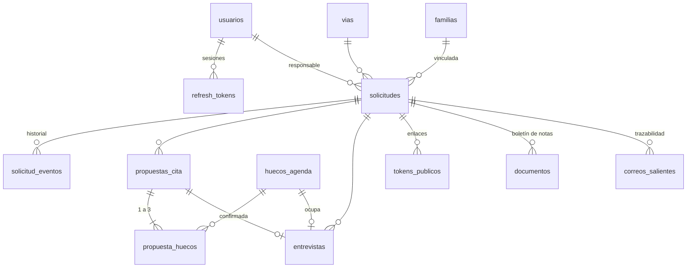

# Flujo, estados y modelo de datos

Cubre las fases 01 y 02 del diagrama de flujo ("Captación" y "Revisión y entrevista"), pasos 1 a 11.

## Recorrido

## Estados de la solicitud

Cualquier estado activo puede pasar a `DESCARTADA` a mano.

### Columnas del kanban

| Columna (mockup) | Estados |
|---|---|
| Solicitud revisada | RECIBIDA, EN_REVISION, PENDIENTE_COMPLETAR |
| Entrevista programada | CITACION_ENVIADA, OTRA_FRANJA_SOLICITADA, ENTREVISTA_PROGRAMADA |
| Evaluada | ENTREVISTA_REALIZADA, EN_ESPERA, ADMITIDA |
| Plaza reservada | PLAZA_RESERVADA |
| Matriculada | MATRICULADA |

La bandeja de admisión muestra RECIBIDA, EN_REVISION, PENDIENTE_COMPLETAR, CITACION_ENVIADA y OTRA_FRANJA_SOLICITADA; cuando la familia elige fecha, la solicitud sale de la bandeja (como en el mockup).

## Reglas de negocio implementadas

| Regla | Dónde |
|---|---|
| Solicitud completa = alumna, tutor, correo válido, teléfono y centro de procedencia | `revision.ts` |
| No se puede citar una solicitud incompleta | `citacion.service.ts › proponer` |
| De 1 a 3 huecos, libres y futuros; ocupados y bloqueados no se pueden proponer | `proponer` |
| Entrevista siempre presencial, con el equipo directivo, en la sala de reuniones de Dirección | `CENTRO` en `config/env.ts` + `CHECK` en BD |
| Un hueco solo puede tener una entrevista, aunque dos familias elijan a la vez | `UPDATE … WHERE estado='LIBRE'` atómico + `UNIQUE(hueco_id)` |
| La cita confirmada aparece sola en el calendario | `elegir` crea la entrevista |
| Recordatorio si no responde en 3 días (uno solo) | `jobs/recordatorios.ts` (`RECORDATORIO_CITA_DIAS`) |
| Recordatorio el día antes, a partir de las 10:00 | `recordatoriosEntrevista` |
| La familia puede cambiar la fecha o pedir otra franja hasta 24 h antes | `HORAS_LIMITE_CAMBIO` |
| Notas: se suben desde el enlace de la cita, hasta el día de la entrevista | `publico.routes.ts` |
| Proponer nuevas fechas anula la propuesta anterior y su enlace | `proponer` |
| Plazas libres = plazas − (admitidas + reservadas + matriculadas); GS concertado: cupo de la Junta | `comun.ts`, `revision.ts` |

## Modelo de datos

| Tabla | Para qué |
|---|---|
| `usuarios`, `refresh_tokens` | Personal del centro, roles y sesiones con rotación |
| `vias` | Familia (Bachillerato, CC GM, CC GS, CP GS) + curso, por curso escolar, con plazas |
| `familias` | Familias conocidas, para "familia ya vinculada" hasta que exista Alumnado |
| `solicitudes` | Expediente de admisión (alumna, contacto, origen, gestión interna, última revisión) |
| `solicitud_eventos` | Historial auditable: quién hizo qué y cuándo (usuario, familia o sistema) |
| `huecos_agenda` | Agenda del equipo directivo (LIBRE / OCUPADO / BLOQUEADO) |
| `propuestas_cita`, `propuesta_huecos` | Cada envío de fechas a una familia |
| `entrevistas` | Citas confirmadas (calendario) |
| `tokens_publicos` | Enlaces personales sin cuenta; solo se guarda el hash |
| `documentos` | Boletín de notas (fichero en disco/S3, metadatos aquí) |
| `correos_salientes` | Cola de correo (outbox) y trazabilidad de envíos |
| `secuencias` | Contador del código `SOL-AAAA-NNNN` |

El SQL completo está en `drizzle/0000_inicial.sql`.

## Decisiones técnicas

- **Correo con outbox.** El correo se guarda en la misma transacción que el cambio (p. ej. la cita confirmada). Un worker lo envía con reintentos exponenciales. Si el SMTP cae, no se pierde ni la cita ni el aviso, y la ficha muestra el estado de cada envío.
- **Varias instancias.** Los workers usan `pg_try_advisory_lock` y `FOR UPDATE SKIP LOCKED`: se puede escalar la API sin duplicar correos ni recordatorios. También se pueden sacar a un proceso aparte con `WORKERS_ENABLED=false` en la API.
- **Horas.** En BD todo es `timestamptz` (UTC); la conversión a hora de Madrid, con cambio de horario, se hace solo en `lib/fechas.ts`.
- **Enlaces públicos.** Tokens de 256 bits; en BD solo su SHA-256. El de la cita es reutilizable hasta el día después de la entrevista (elegir, cambiar, subir notas); el de completar es de un solo uso.
- **Ficheros.** Se valida el tipo real por la firma del fichero, no por la extensión. El almacenamiento está detrás de una interfaz (`lib/storage.ts`) para pasar a S3 sin tocar servicios.
