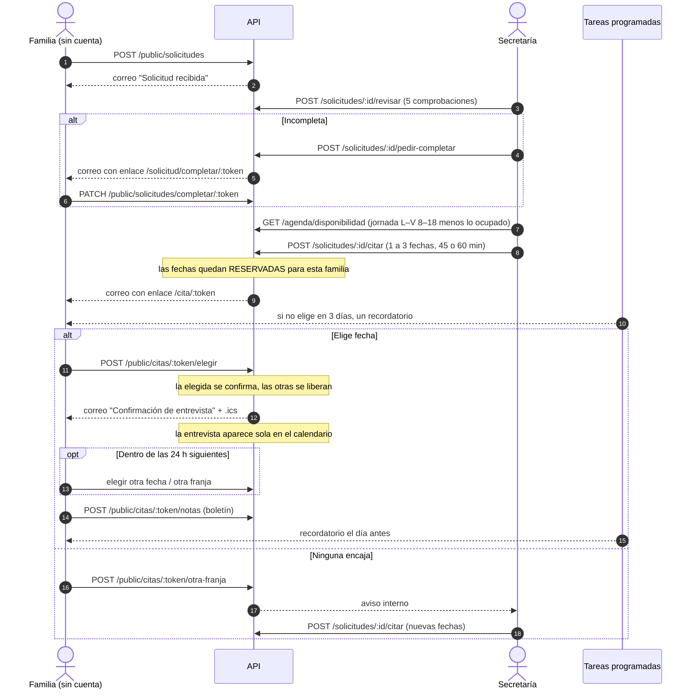
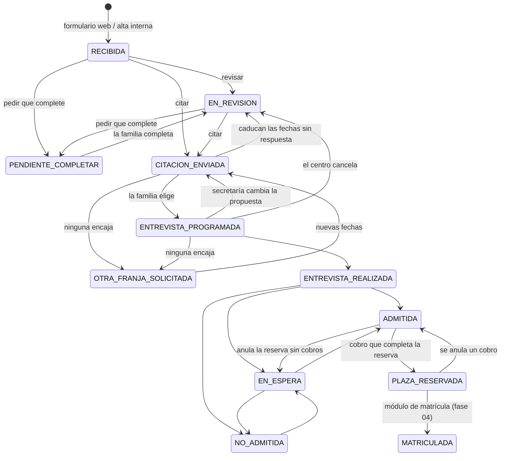
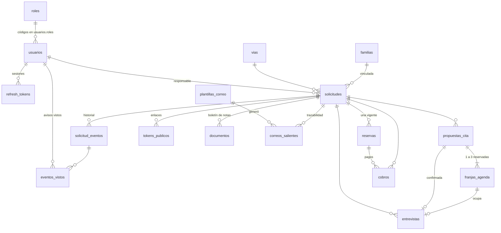

# Flujo, estados y modelo de datos

Cubre las fases 01, 02 y 03 del diagrama de flujo ("Captación", "Revisión y entrevista" y "Evaluación y reserva de plaza"). La fase 04 (matrícula digital) está en pausa.

## Recorrido

## Estados de la solicitud

Cualquier estado activo puede pasar a `DESCARTADA` a mano.

### Columnas del kanban

| Columna (mockup) | Estados |
|---|---|
| Solicitud revisada | RECIBIDA, EN_REVISION, PENDIENTE_COMPLETAR |
| Entrevista programada | CITACION_ENVIADA, OTRA_FRANJA_SOLICITADA, ENTREVISTA_PROGRAMADA |
| Evaluada | ENTREVISTA_REALIZADA, EN_ESPERA, ADMITIDA |
| Plaza reservada | PLAZA_RESERVADA |
| Matriculada | MATRICULADA |

La bandeja de admisión muestra RECIBIDA, EN_REVISION, PENDIENTE_COMPLETAR, CITACION_ENVIADA y OTRA_FRANJA_SOLICITADA; cuando la familia elige fecha, la solicitud sale de la bandeja (como en el mockup).

## Reglas de negocio implementadas

| Regla (validada con el cliente) | Dónde |
|---|---|
| Formulario web: todos los campos obligatorios salvo la modalidad | `solicitudes.schemas.ts` |
| Solicitud completa = alumna, tutor, correo válido, teléfono y centro de procedencia | `revision.ts` |
| No se puede citar una solicitud incompleta | `citacion.service.ts › proponer` |
| Agenda = jornada laboral (L–V 8:00–18:00, configurable) menos lo ocupado; la disponibilidad se reduce sola | `agenda.service.ts › disponibilidad` |
| La entrevista dura 45 o 60 minutos | ajuste `agenda.duraciones` |
| Se proponen de 1 a 3 fechas dentro de la jornada | `proponer` |
| Las fechas propuestas quedan **reservadas** hasta que la familia elige; nadie más puede ocuparlas | franjas `RESERVADA` + restricción `EXCLUDE` en BD |
| Al elegir, la elegida se confirma y las otras vuelven a estar libres | `elegir` |
| La familia solo puede cambiar la fecha durante las 24 h siguientes a aceptarla (el plazo no se renueva al cambiar) | `HORAS_PARA_CAMBIAR`, `propuestas_cita.confirmada_en` |
| Entrevista siempre presencial, con el equipo directivo, en la sala de reuniones de Dirección | `CENTRO` en `config/env.ts` + `CHECK` en BD |
| La cita confirmada aparece sola en el calendario | `elegir` crea la entrevista |
| Un único recordatorio si no elige fecha en 3 días, con plantilla HTML | `jobs/recordatorios.ts` |
| Recordatorio el día antes de la entrevista, con plantilla HTML | `recordatoriosEntrevista` |
| Las notas se piden con la cita (se suben desde el mismo enlace) | `publico.routes.ts` |
| Si las fechas pasan sin respuesta, la propuesta caduca, se liberan y la solicitud vuelve a revisión | `caducarPropuestas` |
| Proponer nuevas fechas anula la propuesta anterior, libera sus horas y su enlace | `proponer` |
| Plazas libres = plazas − (admitidas + reservadas + matriculadas); GS concertado: cupo de la Junta | `comun.ts`, `revision.ts` |
| Cuatro perfiles: Dirección (superadmin), Administración, Secretaría y Comercial; permisos ver/editar por módulo editables | `permisos/` |
| Solo Dirección registra la decisión de admisión (por defecto) | permiso `evaluacion.editar` |
| Todos los correos salen de plantillas HTML editables por evento | `correo/`, `comunicaciones/` |
| La decisión de admisión se registra con "Registrar decisión" y, si se pide, notifica a la familia; arrastrando en el kanban no se puede | `evaluacion.service.ts › decidir`, `cambiarEstadoManual` |
| Admitir crea la reserva: 300 € para todas las vías (configurable por vía), 15 días naturales, transferencia o efectivo | `ajustes.reserva`, `crearReserva` |
| Lista de espera ordenada por vía y por fecha de entrada; el correo lleva la posición | `posicionesEnEspera` |
| Cobro manual con recibo de la serie R; pagos parciales; nunca más de lo pendiente | `cobros.service.ts › registrar` |
| Al cubrir la reserva: reserva pagada y solicitud en "Plaza reservada", en la misma transacción | `registrar` |
| Un cobro no se borra: se anula con motivo, y si la reserva queda sin cubrir, la plaza vuelve a "Admitida" | `anular` |
| Un único recordatorio a 3 días del plazo; "Recordar" lo envía antes, y entonces el automático ya no sale | `reservas.service.ts › recordatoriosPago`, `recordar` |
| Reserva vencida: aviso a secretaría y administración; la plaza no se libera sola | `vencerReservas` |

## Modelo de datos

| Tabla | Para qué |
|---|---|
| `roles` | Los cuatro perfiles y sus permisos (`solicitudes.ver`, `cobros.editar`…). Dirección es superadmin. |
| `usuarios`, `refresh_tokens` | Personal del centro, sus roles y sesiones con rotación |
| `ajustes` | Configuración editable: horario de la agenda (jornada, duraciones, días no lectivos) |
| `vias` | Familia (Bachillerato, CC GM, CC GS, CP GS) + curso, por curso escolar, con plazas |
| `familias` | Familias conocidas, para "familia ya vinculada" hasta que exista Alumnado |
| `solicitudes` | Expediente de admisión (alumna, contacto, origen, gestión interna, última revisión) |
| `solicitud_eventos` | Historial auditable: quién hizo qué y cuándo (usuario, familia o sistema) |
| `eventos_vistos` | Aviso "la familia ya eligió fecha": qué respuestas de la familia ha visto ya cada usuario |
| `franjas_agenda` | Lo que ocupa la agenda: `RESERVADA` (propuesta), `CONFIRMADA` (entrevista), `BLOQUEADA` (manual), `LIBERADA` (histórico). Restricción `EXCLUDE`: dos franjas activas nunca se solapan. |
| `propuestas_cita` | Cada envío de fechas a una familia, con su duración y cuándo aceptó (`confirmada_en`) |
| `entrevistas` | Citas confirmadas (calendario) |
| `tokens_publicos` | Enlaces personales sin cuenta; solo se guarda el hash |
| `documentos` | Boletín de notas (fichero en la carpeta de uploads, metadatos aquí) |
| `plantillas_correo` | Plantillas HTML por evento; una activada por evento (índice único parcial) |
| `correos_salientes` | Cola de correo (outbox) e histórico de envíos |
| `reservas` | Reserva de plaza al admitir: importe (céntimos), fecha límite y estado (`PENDIENTE`, `PAGADA`, `VENCIDA`, `ANULADA`). Índice único parcial: una vigente por solicitud |
| `cobros` | Cobros manuales con su recibo `R-AAAA-NNNN`. Nunca se borran: se anulan con motivo |
| `secuencias` | Contadores del código de solicitud (`B-AAAA-NNNN` Bachillerato, `C-AAAA-NNNN` Ciclos; las anteriores, `SOL-AAAA-NNNN`) y de los recibos `R-AAAA-NNNN` |

El SQL está en `drizzle/0000_inicial.sql`, `0001_agenda_sin_solapes.sql`, `0002_avisos_familia.sql`, `0003_reserva_y_cobros.sql` y `0004_reservas_admitidas_antiguas.sql`. Esta última es solo de datos, escrita a mano: crea la reserva de las solicitudes admitidas antes de la fase 03.

Los importes se guardan siempre en céntimos (enteros), nunca con decimales.

## Decisiones técnicas

- **Agenda sin huecos precreados.** No hay que "generar" la agenda: la disponibilidad se calcula cada vez a partir de la jornada y de lo que ya está ocupado. Cambiar el horario no requiere migrar datos.
- **Sin dobles reservas, garantizado por la BD.** La restricción `EXCLUDE USING gist` sobre el rango horario impide que dos franjas activas se solapen, aunque dos personas pulsen a la vez. La API traduce ese rechazo a un 409 con mensaje claro.
- **Correo con outbox.** El correo se guarda en la misma transacción que el cambio (p. ej. la cita confirmada). Un worker lo envía cada 15 s con reintentos exponenciales. Si el SMTP cae, no se pierde ni la cita ni el aviso, y el histórico muestra el estado de cada envío.
- **Plantillas seguras.** El HTML que escribe el centro se sanea al guardar; las variables de texto se escapan al enviar; los bloques que genera el sistema (lista de fechas, botón) se insertan tal cual.
- **Permisos en caliente.** Se leen de la BD en cada petición (con caché de 10 s), así que un cambio en la matriz aplica sin cerrar sesiones.
- **Varias instancias.** Los workers usan `pg_try_advisory_lock` y `FOR UPDATE SKIP LOCKED`: se puede escalar la API sin duplicar correos ni recordatorios.
- **Horas.** En BD todo es `timestamptz` (UTC); la conversión a hora de Madrid, con cambio de horario, se hace solo en `lib/fechas.ts`.
- **Enlaces públicos.** Tokens de 256 bits; en BD solo su SHA-256. El de la cita vale hasta el día después de la entrevista (elegir, cambiar, subir notas); el de completar es de un solo uso.
- **Ficheros.** Se valida el tipo real por la firma del fichero, no por la extensión. Hoy se guardan en una carpeta de tu equipo; el almacenamiento está detrás de una interfaz (`lib/storage.ts`) para pasar a la nube sin tocar los servicios.
